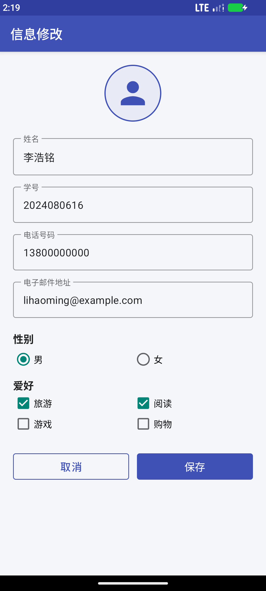
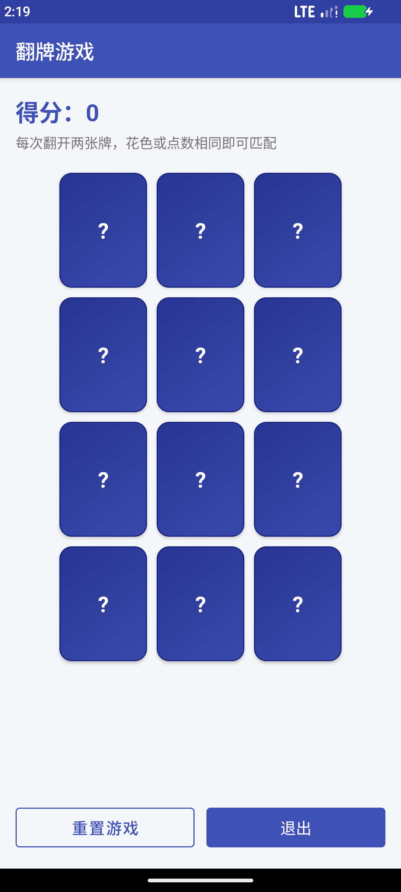
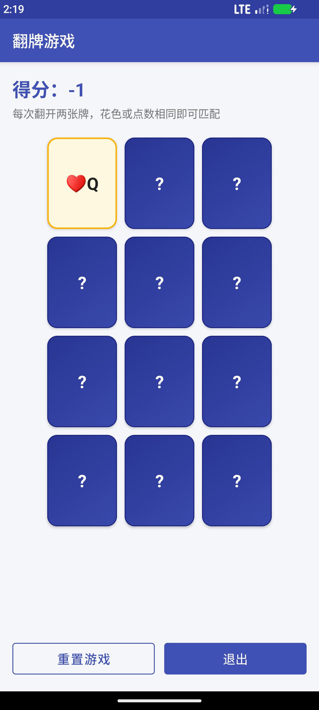
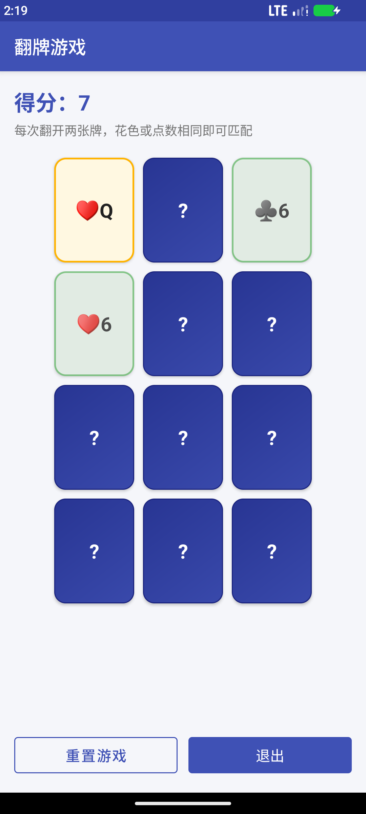
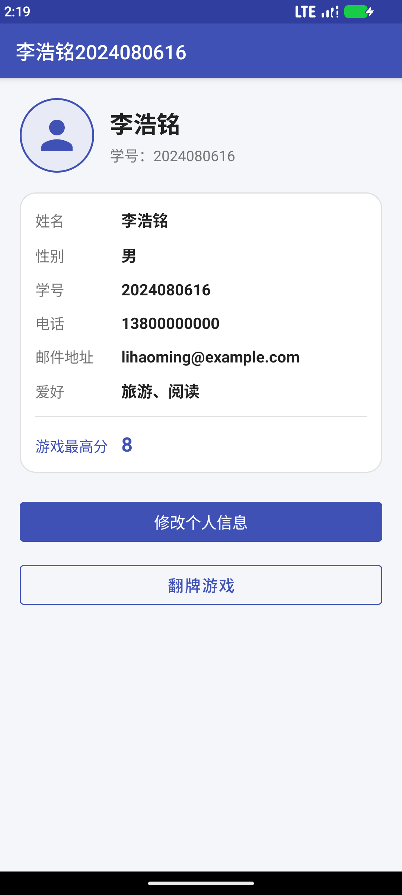

# 实验四《翻牌游戏应用》实验报告填写指南

> 配套工程已在本目录完成：3 个 Activity、MVC 翻牌游戏、单元测试和 UI 测试。
> 运行截图在 `screenshots/`，测试输出在 `test-results/`。
> 本文按学院实验报告模板的栏目组织，标有“可直接填写”的部分可以复制到报告里；
> 标有“需要自己补充”的部分请按实际情况填写。

---

## 〇、提交前先改这几处

| 位置 | 当前内容 | 是否需要修改 |
| --- | --- | --- |
| `app/src/main/res/values/strings.xml` → `app_name` | `李浩铭2024080616` | 姓名/学号不同则修改 |
| 报告封面：班级、日期 | 空 | 自己填写 |
| 报告封面：Gitee 网址 | 空 | 把项目推送到 Gitee 后填写 |
| 报告封面：实验成绩 | 空 | 留给老师 |

APP 的应用标题已经按要求设置为“姓名+学号”。安装后 ActionBar 左上角显示的
`李浩铭2024080616` 就是 `app_name` 的值，见运行截图 `screenshots/01_main.png`。

---

## 一、封面与表头（可直接填写）

- 实验编号：4
- 课程名称：Android 移动应用开发
- 实验名称：翻牌游戏应用
- 姓名：李浩铭
- 学号：2024080616
- 指导老师：李贵洋
- 班级、日期、Gitee 网址：自行补充
- 实验成绩：留空

---

## 二、实验目的及要求（照抄模板即可）

### 1. 实验目的

1. 掌握 Android 多种布局和控件的使用；
2. 掌握 MVC 设计模式。

### 2. 实验要求

1. 认真填写实验报告，要求附加部分运行界面和主要代码；
2. 对设计好的程序，检查输出是否符合预期，如有错请分析错误原因并解决。

---

## 三、实验内容（可直接填写）

本实验完成了一个包含 3 个 Activity 的 Android 应用：

1. **主 Activity（`MainActivity`）**：显示当前玩家的头像、姓名、性别、学号、
   电话、邮件地址、爱好以及游戏最高分。页面底部提供“修改个人信息”和“翻牌游戏”
   两个入口。
2. **信息修改 Activity（`InfoEditActivity`）**：读取主界面传入的个人信息并回显，
   可以修改姓名、学号、电话号码、电子邮件地址、性别和爱好；点击“保存”后把修改
   结果返回主界面，点击“取消”则放弃修改。按实验要求，修改后的信息不写入文件。
3. **翻牌游戏 Activity（`CardGameActivity`）**：显示 12 张背面朝上的牌，使用 3 列
   × 4 行的网格排列。玩家每次点击翻开一张牌，连续翻开两张时由模型判断是否匹配：
   - 点数相同：匹配，得 `4 × MATCH_BONUS = 16` 分；
   - 花色相同：匹配，得 `1 × MATCH_BONUS = 4` 分；
   - 不匹配：扣 `MISMATCH_PENALTY = 2` 分，并把前一张牌翻回去；
   - 每翻开一张牌固定扣 `COST_TO_CHOOSE = 1` 分。
   界面顶部实时显示得分，底部提供“重置游戏”和“退出”按钮。退出时把本局的最高
   分返回给主界面，主界面刷新“游戏最高分”。

程序采用 MVC 思路组织：

- **Model（模型）**：`Card`、`Deck`、`CardMatchingGame`，使用附件提供的代码，
  只给 `CardMatchingGame` 增加了一个只读的 `numberOfCards` 属性，方便界面遍历。
- **View（视图）**：`activity_main.xml`、`activity_info_edit.xml`、
  `activity_card_game.xml`，以及 `bg_card_back.xml` 等 drawable。游戏牌面由
  `CardGameActivity` 在 `GridLayout` 中动态创建。
- **Controller（控制器）**：三个 Activity。`CardGameActivity` 接收点击事件，调用
  `CardMatchingGame.chooseCardAtIndex()`，再根据最新的
  `isChosen` / `isMatched` / `score` 刷新界面。

界面中所有对用户可见的文字都放在 `res/values/strings.xml` 中，布局文件和 Kotlin
代码没有直接写死界面字符串。主题按实验补充说明改成
`Theme.MaterialComponents.DayNight.DarkActionBar.Bridge`，按钮背景色可以正常显示。

---

## 四、实验核心代码与说明

> 报告模板写的是“核心代码截图和说明”。如果老师要求截图，请在 Android Studio 中
> 打开下列文件和方法截图；如果允许直接粘贴代码，可复制本节代码。
> 建议截图位置：
>
> 1. `CardMatchingGame.kt` 的 `chooseCardAtIndex()`（匹配与计分逻辑）
> 2. `CardGameActivity.kt` 的 `createCardViews()`、`chooseCard()`、`updateUI()`、
>    `resetGame()`（Controller 核心）
> 3. `MainActivity.kt` 的 `infoEditLauncher`、`cardGameLauncher`、`renderProfile()`
> 4. `InfoEditActivity.kt` 的 `showProfile()`、`saveProfile()`
> 5. `activity_card_game.xml` 中的 `GridLayout`
> 6. `themes.xml` 中的主题父类

### 4.1 模型：牌与匹配规则（`Card.kt`）

```kotlin
fun match(otherCards: Array<Card>): Int {
    var score = 0
    if (otherCards.size == 1) {
        val otherCard = otherCards[0]
        if (otherCard.rank == rank) {
            score = 4          // 点数相同
        } else if (otherCard.suit == suit) {
            score = 1          // 花色相同
        }
    }
    return score
}
```

说明：`match()` 只负责给出匹配分数，不修改任何状态；是否加分、是否标记为已匹配
由 `CardMatchingGame` 决定。这是 MVC 中模型内部职责分离的体现。

### 4.2 模型：发牌与计分（`Deck.kt` / `CardMatchingGame.kt`）

`Deck` 在初始化时生成 4 种花色 × 13 种点数的 52 张牌，`drawRandomCard()` 随机
抽走一张并返回。`CardMatchingGame` 从牌堆中抽 12 张牌作为一局。

```kotlin
fun chooseCardAtIndex(index: Int) {
    val card = cardAtIndex(index)
    if (!card.isMatched) {
        if (card.isChosen) {
            card.isChosen = false                 // 再次点击已翻开的牌：翻回去
        } else {
            for (otherCard in cards) {
                if (otherCard.isChosen && !otherCard.isMatched) {
                    val matchScore = card.match(arrayOf(otherCard))
                    if (matchScore > 0) {
                        score += matchScore * MATCH_BONUS
                        otherCard.isMatched = true
                        card.isMatched = true
                    } else {
                        score -= MISMATCH_PENALTY
                        otherCard.isChosen = false
                    }
                    break
                }
            }
            score -= COST_TO_CHOOSE
            card.isChosen = true
        }
    }
}
```

说明：

- 已匹配的牌不能再次选择；
- 有且只有一张已选择、未匹配的牌时才进行比较；
- 匹配成功后两张牌都标记为 `isMatched`，界面会保持正面并变绿；
- 不匹配时把之前那张牌翻回去，当前牌继续正面显示；
- `score` 使用 `private set`，只能由模型内部修改，避免控制器直接改分。

### 4.3 视图：3×4 翻牌网格（`activity_card_game.xml`）

```xml
<GridLayout
    android:id="@+id/card_grid"
    android:layout_width="wrap_content"
    android:layout_height="wrap_content"
    android:layout_gravity="center_horizontal"
    android:layout_marginTop="16dp"
    android:columnCount="3"
    android:rowCount="4"
    android:useDefaultMargins="false" />
```

每张牌的宽高、圆角背景、文字颜色由 `CardGameActivity.createCardViews()` 动态设置：

```kotlin
for (index in 0 until CARD_COUNT) {
    val cardView = TextView(this).apply {
        layoutParams = GridLayout.LayoutParams().apply {
            width = cardWidth
            height = cardHeight
            setMargins(margin, margin, margin, margin)
        }
        gravity = Gravity.CENTER
        textSize = 22f
        setTypeface(typeface, Typeface.BOLD)
        isClickable = true
        isFocusable = true
        contentDescription = getString(R.string.card_description, index + 1)
        setOnClickListener { chooseCard(index) }
    }
    binding.cardGrid.addView(cardView)
    cardViews.add(cardView)
}
```

三种牌面样式由 `res/drawable/` 下的三个 shape 实现：

- `bg_card_back.xml`：蓝紫色渐变牌背，显示 `?`；
- `bg_card_chosen.xml`：浅黄色底 + 橙色描边，表示正在选择的牌；
- `bg_card_matched.xml`：浅绿色底 + 绿色描边，表示已匹配的牌。

牌背、选中、匹配三种状态都在 `updateUI()` 中统一刷新：

```kotlin
private fun updateUI() {
    binding.scoreText.text = getString(R.string.score_format, game.score)

    for (index in cardViews.indices) {
        val card = game.cardAtIndex(index)
        val view = cardViews[index]
        when {
            card.isMatched -> {          // 已匹配：保持正面，绿色
                view.text = card.toString()
                view.setTextColor(getColor(R.color.text_primary))
                view.setBackgroundResource(R.drawable.bg_card_matched)
                view.alpha = 0.75f
            }
            card.isChosen -> {           // 已翻开：显示点数与花色
                view.text = card.toString()
                view.setTextColor(getColor(R.color.text_primary))
                view.setBackgroundResource(R.drawable.bg_card_chosen)
                view.alpha = 1f
            }
            else -> {                    // 背面
                view.text = getString(R.string.card_back)
                view.setTextColor(Color.WHITE)
                view.setBackgroundResource(R.drawable.bg_card_back)
                view.alpha = 1f
            }
        }
    }
}
```

### 4.4 控制器：接收交互并同步模型与界面（`CardGameActivity.kt`）

```kotlin
private fun chooseCard(index: Int) {
    game.chooseCardAtIndex(index)                  // 1. 交给模型处理
    highestScore = maxOf(highestScore, game.score) // 2. 记录本局最高分
    updateUI()                                     // 3. 模型状态同步到界面
}

private fun resetGame() {
    game = CardMatchingGame(CARD_COUNT)            // 重新发牌，开始新一局
    gameOverAnnounced = false
    updateUI()
}
```

说明：Activity 不修改 `Card` 的匹配状态，也不自己计算分数，只负责把点击转换成
模型调用，再把模型状态映射成界面。这样 View、Model、Controller 的职责清晰。

### 4.5 主界面与信息修改的数据传递（`MainActivity.kt` / `InfoEditActivity.kt`）

`Profile` 实现了 `Serializable`，通过 Intent 在 Activity 之间传递，不写入文件：

```kotlin
data class Profile(
    var name: String,
    var gender: String,
    var studentId: String,
    var phone: String,
    var email: String,
    var hobbies: ArrayList<String>,
    var highScore: Int = 0
) : Serializable
```

主界面用 Activity Result API 接收信息修改结果：

```kotlin
private val infoEditLauncher =
    registerForActivityResult(ActivityResultContracts.StartActivityForResult()) { result ->
        if (result.resultCode == RESULT_OK) {
            val updated = result.data
                ?.getSerializableExtra(InfoEditActivity.EXTRA_PROFILE) as? Profile
            if (updated != null) {
                profile = updated
                renderProfile()
            }
        }
    }
```

信息修改界面读取传入的 `Profile` 回显到输入框、单选按钮和复选框；“保存”时校验
姓名和电话，再把新的 `Profile` 放入结果 Intent：

```kotlin
val updated = profile.copy(
    name = name,
    gender = getString(
        if (binding.rbFemale.isChecked) R.string.gender_female else R.string.gender_male
    ),
    studentId = binding.etStudentId.text?.toString()?.trim().orEmpty(),
    phone = phone,
    email = binding.etEmail.text?.toString()?.trim().orEmpty(),
    hobbies = selectedHobbies()
)
setResult(RESULT_OK, Intent().putExtra(EXTRA_PROFILE, updated))
finish()
```

“取消”时调用 `setResult(RESULT_CANCELED)` 并 `finish()`，主界面不刷新，原信息保留。
主界面的 `renderProfile()` 统一把 `Profile` 的字段写入各个 TextView，避免重复代码。

游戏最高分的传递同理：进入游戏时把当前最高分放入 Intent，游戏过程中用
`highestScore = maxOf(highestScore, game.score)` 记录，退出时通过 `setResult()`
返回，主界面收到后更新“游戏最高分”。

### 4.6 主题与字符串资源

按实验补充说明，把 `themes.xml` 的父主题改为：

```xml
<style name="Theme.MyApplication"
    parent="Theme.MaterialComponents.DayNight.DarkActionBar.Bridge">
    ...
</style>
```

这样可以解决 Material 3 主题下按钮设置背景后不生效的问题。应用标题、按钮文字、
提示语、错误信息、Toast 等内容全部放在 `strings.xml` 中，例如：

```xml
<string name="app_name">李浩铭2024080616</string>
<string name="btn_edit_info">修改个人信息</string>
<string name="btn_play_game">翻牌游戏</string>
<string name="score_format">得分：%1$d</string>
<string name="card_back">?</string>
<string name="game_over">恭喜，全部卡片已匹配！</string>
```

代码中使用 `getString(R.string.score_format, game.score)` 等格式化方法拼接动态内容，
没有在布局或代码里直接写用户可见的字符串。

---

## 五、作品最终运行过程截图与说明

截图均由本工程在 `Medium_Phone` 模拟器（API 37，1080×2400）上实际运行后截取，
可直接插入报告（图片在 `screenshots/` 目录）。

### 图 1 主界面（`01_main.png`）


说明：ActionBar 显示 APP 标题“李浩铭2024080616”；页面显示头像、姓名、学号，
以及姓名、性别、学号、电话、邮件地址、爱好和游戏最高分。底部两个按钮分别进入
信息修改和翻牌游戏。

### 图 2 信息修改界面（`02_info_edit.png`）



说明：输入框回显主界面传入的信息；性别使用 `RadioGroup`，爱好使用 `CheckBox`；
点击“保存”后返回主界面并刷新，点击“取消”放弃修改。所有文字均来自字符串资源。

### 图 3 游戏初始界面（`03_game_start.png`）



说明：12 张牌按 3 列 × 4 行排布，初始全部背面朝上，显示 `?`；顶部得分为 0，
下方有“重置游戏”和“退出”按钮。

### 图 4 翻开一张牌（`04_game_flip.png`）



说明：点击第一张牌后显示 `♥Q`，该牌呈浅黄色选中态；因为每次翻牌固定扣 1 分，
得分由 0 变为 -1。这验证了 `COST_TO_CHOOSE` 和界面同步逻辑。

### 图 5 匹配成功（`05_game_matched.png`）



说明：两张点数为 6 的牌（`♥6`、`♣6`）匹配成功，两张牌保持正面并变为浅绿色；
得分变为 7。匹配后这两张牌不能再被选择。

### 图 6 返回主界面后的最高分（`06_main_after_game.png`）



说明：点击“退出”返回主界面，游戏过程中达到的最高分 8 被带回主界面并显示在
“游戏最高分”一栏，验证了游戏 Activity 与主 Activity 之间的数据回传。

---

## 六、测试过程与结果

### 6.1 单元测试（JUnit 4）

测试文件：`app/src/test/java/cn/edu/sicnu/cardgame/ModelTest.kt`

| 编号 | 测试内容 | 预期 | 结果 |
| --- | --- | --- | --- |
| 1 | 点数相同的两张牌 | `match()` 返回 4 | 通过 |
| 2 | 花色相同的两张牌 | `match()` 返回 1 | 通过 |
| 3 | 点数和花色都不同 | `match()` 返回 0 | 通过 |
| 4 | 传入 0 张或多张牌 | `match()` 返回 0 | 通过 |
| 5 | 从牌堆抽 52 张牌 | 52 张且互不相同 | 通过 |
| 6 | 空牌堆继续抽牌 | 返回 `null` | 通过 |
| 7 | 新游戏初始状态 | 得分 0、12 张牌 | 通过 |
| 8 | 选牌扣 1 分、再次点击撤销 | 得分 -1、`isChosen` 恢复 | 通过 |
| 9 | 找到一对匹配牌并选择 | 得分增加、两张牌均 `isMatched` | 通过 |

运行命令：

```bash
./gradlew :app:testDebugUnitTest
```

运行结果：**9 个用例全部通过**（0 failures，0 errors）。

### 6.2 UI 测试（Espresso）

测试文件：

- `app/src/androidTest/java/cn/edu/sicnu/cardgame/MainActivityTest.kt`
- `app/src/androidTest/java/cn/edu/sicnu/cardgame/CardGameActivityTest.kt`

| 编号 | 测试内容 | 预期 | 结果 |
| --- | --- | --- | --- |
| 1 | 主界面 → 修改姓名 → 保存 | 主界面显示“测试同学” | 通过 |
| 2 | 修改姓名 → 取消 | 主界面仍显示原姓名 | 通过 |
| 3 | 主界面点击“翻牌游戏” | 进入游戏，得分显示 0 | 通过 |
| 4 | 点击第一张牌再点“重置游戏” | 得分 -1 → 0 | 通过 |
| 5 | 游戏初始状态 | 12 张牌都显示 `?` | 通过 |

在 Android Studio 中可以直接右键测试类运行；命令行运行方式：

```bash
./gradlew :app:connectedDebugAndroidTest
```

如果网络无法下载 UTP 测试平台依赖，也可以使用已经编译好的 APK：

```bash
adb install -r app/build/outputs/apk/debug/app-debug.apk
adb install -r app/build/outputs/apk/androidTest/debug/app-debug-androidTest.apk
adb shell am instrument -w -r \
  cn.edu.sicnu.cardgame.test/androidx.test.runner.AndroidJUnitRunner
```

运行结果：**5 个用例全部通过（OK (5 tests)）**。完整输出见
`test-results/ui-test-output.txt`。

> 提示：运行 Espresso 前建议关闭模拟器动画，否则可能出现
> “Animations or transitions are enabled on the target device”：
>
> ```bash
> adb shell settings put global window_animation_scale 0
> adb shell settings put global transition_animation_scale 0
> adb shell settings put global animator_duration_scale 0
> ```

---

## 七、实验结果的分析与评价（可直接填写，按需删改）

### 7.1 完成情况

本实验完成了全部要求：3 个 Activity 均已实现并可以在模拟器上正常运行；主界面
能显示玩家基本信息和最高分；信息修改界面能修改并回填个人信息；翻牌游戏实现了
12 张牌的随机发牌、翻开/翻回、匹配判断、计分、重置和退出，并在退出时把最高分
返回主界面。界面采用统一的主色、圆角牌面和固定网格布局，满足“规整美观”的要求。
MVC 分工明确：模型只负责牌、发牌和计分，控制器只负责交互和同步界面。

### 7.2 调试中遇到的问题与解决

1. **按钮背景不显示。** 新版 Android Studio 默认使用 Material 3 主题，按实验
   补充说明把 `themes.xml` 的父主题改为
   `Theme.MaterialComponents.DayNight.DarkActionBar.Bridge` 后解决。
2. **targetSdk 37 下内容被 ActionBar 遮挡。** 在 API 37 模拟器上第一次运行时，
   targetSdk 37 强制 edge-to-edge，页面顶部的头像和姓名被 ActionBar 盖住，
   UI 测试也因为按钮不可见而失败。分析后把 `targetSdk` 调整为 34（`compileSdk`
   仍为 37），恢复经典的“内容位于 ActionBar 下方”的布局后解决。若以后需要
   targetSdk 35+，应使用 `WindowInsetsCompat` 为根布局增加顶部内边距。
3. **Espresso 报动画错误。** 模拟器动画开启时，点击和滚动会出现
   “Animations or transitions are enabled on the target device”。关闭窗口、过渡
   和动画时长三个系统动画缩放后，UI 测试稳定通过。
4. **本机无法下载 UTP 依赖。** `connectedDebugAndroidTest` 在下载测试平台组件时
   因网络 DNS 解析失败。由于测试 APK 已经编译成功，改用
   `adb shell am instrument` 直接运行同一套 Espresso 测试，5 个用例全部通过。
   在联网正常的机器上仍可以使用 Android Studio 或
   `connectedDebugAndroidTest` 运行。

### 7.3 不足与改进

- 按实验要求，修改后的个人信息不保存到文件，因此退出应用后会恢复默认值；最高分
  也只在本应用进程内有效。若需要持久化，可以使用 `SharedPreferences` 或 Room
  保存 `Profile` 和最高分。
- 目前牌面使用文字（花色 + 点数），没有使用图片素材；可以替换为扑克牌图片，
  并加入翻牌动画、音效和计时功能。
- 12 张牌由牌堆随机抽取，虽然同花色对子一定存在，但不能保证所有 12 张牌都能
  两两配对。改进方法是在发牌时按对生成牌组，保证一局可以完全匹配，并在一局
  结束时弹出结算对话框。
- 当前只支持两人规则中的单人对局，可扩展为双人对战、难度选择（不同牌数）等。

### 7.4 自我评价

通过本次实验，我熟悉了 `LinearLayout`、`ScrollView`、`GridLayout`、
`TextInputLayout`、`RadioGroup`、`CheckBox` 等布局和控件的使用，理解了 MVC
模式中模型、视图、控制器的职责边界，也掌握了 Activity 之间通过 Intent 传递数据、
使用 Activity Result API 接收返回结果的方法。单元测试和 Espresso UI 测试帮助我
发现了 targetSdk 和动画导致的真实问题，提高了调试和验证代码的能力。

---

## 八、提交前检查清单

- [ ] `app_name` 是“姓名+学号”（本工程为 `李浩铭2024080616`）。
- [ ] 实验报告封面的班级、日期、Gitee 网址已填写。
- [ ] Gitee 仓库已创建并推送本工程（不要提交 `build/`、`.gradle/`、
      `local.properties`、`.idea/` 等目录，项目已提供 `.gitignore`）。
- [ ] 报告中插入了运行截图（至少主界面、信息修改、翻牌游戏、匹配成功）。
- [ ] 如果老师要求“代码截图”，按第四节列出的 6 个位置在 Android Studio 中截图。
- [ ] 报告中说明了主要代码的作用和数据传递过程。
- [ ] 报告“实验结果的分析与评价”填写了完成情况、问题与解决、不足与改进。
- [ ] 实验报告用附件形式提交，文件名建议包含姓名和学号。

---

## 九、在 Android Studio 中运行与复现

1. 打开 Android Studio，选择 Open，打开本目录
   `C:\Android\bzdmtc\android_lesson4`。
2. 等待 Gradle Sync；本机 `local.properties` 已指向
   `C:\Android\Android\sdk`。
3. 启动 `Medium_Phone` 模拟器，点击 Run 运行 `app`。
4. 运行单元测试：在 Project 视图找到
   `app/src/test/java/.../ModelTest.kt`，右键 → Run。
5. 运行 UI 测试：右键 `MainActivityTest.kt` 或 `CardGameActivityTest.kt` → Run。
6. 如果修改了姓名/学号，记得同步修改 `strings.xml` 中的 `app_name`，并重新
   截图。

全部代码、截图和测试结果已经保存在本目录，可直接用于报告和 Gitee 提交。
